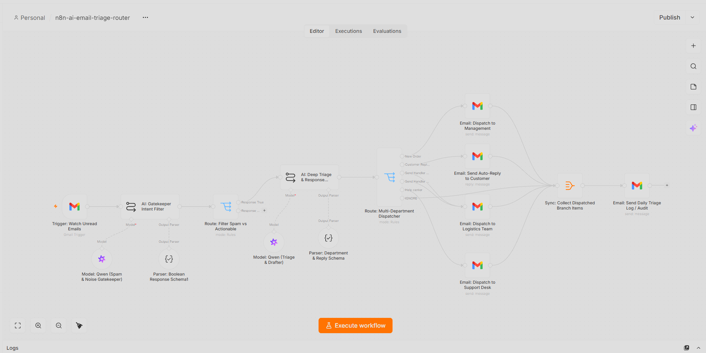
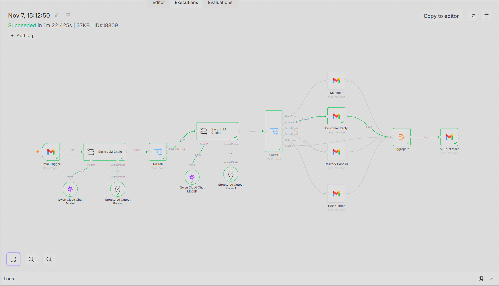

# 📧 AI Email Triage, Multi-Department Dispatcher & Audit System

An enterprise-grade, autonomous customer support and email management system orchestrated in **n8n**. This intelligent workflow acts as a 24/7 digital operations manager. It monitors unread Gmail messages, utilizes **Alibaba Cloud Qwen LLMs** as a noise/spam gatekeeper, performs deep triage to categorize inquiries (New Orders, Order Status, Delivery, Complaints), dispatches structured data to respective internal departments (Management, Logistics, Support), auto-replies to customers, and compiles a daily audit summary log—all running securely on a **self-hosted Docker infrastructure on a local server**.

---

## 🌟 Executive Summary
Managing high volumes of customer support emails can overwhelm small teams. This automated pipeline completely automates the inbound triage workflow. It filters out irrelevant spam, analyzes customer intent with high precision, routes complaints directly to management with CC oversight, dispatches logistics inquiries to fulfillment teams, drafts empathetic auto-replies, and logs daily performance metrics. All backend executions run locally via Docker for absolute data privacy and security.

---

## 🖼️ System Architecture & Execution Proofs

### 1. Core n8n Workflow Architecture
*The complete multi-agent orchestration canvas showing Gmail triggers, Qwen gatekeepers, intent filters, multi-department routers, and audit aggregation nodes:*

### 2. Successful Pipeline Execution
*Live execution logs showing successful data flow, multi-branch routing, and green ticks across all triage and dispatch nodes:*

---

## ⚙️ Core Tech Stack & AI Models

### 1. Infrastructure & Orchestration
- **Engine:** n8n (Self-Hosted via Docker Desktop on Local Server Environment)
- **Trigger:** Gmail Trigger (Polls unread customer support threads every minute).

### 2. AI Intelligence & Models
- **Gatekeeper Model:** Alibaba Cloud Qwen (`qwen3.7-flash`) for rapid spam and noise filtering.
- **Deep Triage & Drafter Model:** Alibaba Cloud Qwen (`qwen3.7-plus`) configured for complex customer sentiment analysis and response drafting.
- **Output Parsers:** Strict JSON schema parsers ensuring clean boolean flags, categorical enums, and structured extraction objects.

### 3. Department Routing & Action Layer
- **Multi-Branch Switch:** Dynamically routes emails based on categories (`new_order`, `order_status`, `delivery_inquiry`, `complaint`, `ignore`).
- **Communication Dispatchers:** Gmail API nodes for department-specific notifications, customer auto-replies, and daily audit log aggregation.

---

## 🚀 The Automated Pipeline Flow

1. **Email Ingestion:** The `Gmail Trigger` monitors incoming unread customer threads in real-time.
2. **Intent Gatekeeping:** The Qwen gatekeeper model scans the subject and snippet to determine if the email requires a business response (`requires_response: true/false`).
3. **Deep Triage & Extraction:** Actionable emails are passed to the advanced Qwen triage agent, which extracts customer details, order numbers, and drafts a polite, empathetic response.
4. **Multi-Department Routing:** The switch node dispatches the extracted summary and context to the appropriate internal team (Management, Logistics, or Support Desk) while ensuring complaints always CC the manager.
5. **Audit Logging & Sync:** The aggregation node collects dispatched branch items and compiles a comprehensive daily audit log email for administrative review.

---

## 👨‍💻 Engineering Highlights & Problem Solving

- **Secure Dockerized Local Environment:** Fully hosted on a local Docker container, ensuring complete confidentiality for customer communications, order histories, and internal staff email routing.
- **Multi-Tier AI Filtering:** Implemented a two-stage LLM architecture (Gatekeeper + Deep Triage) to drastically reduce unnecessary token costs and prevent marketing spam from reaching internal department queues.
- **Complex Branch Aggregation:** Utilized n8n aggregate and sync nodes to successfully merge multi-department dispatch branches into a single unified audit reporting flow.

---
*Architected and Developed by **Abu Bakar Siddique** (@hafiz-abubakar-dev) — AI Automation Engineer*
